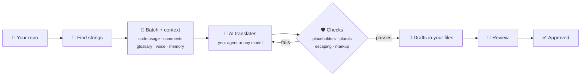

<div align="center">

# 🌍 Localship

**Translate your app with the AI you already use.**

Free and open source · No account, no server · Any AI model · Every translation checked

[](https://github.com/jigarfumakiya/localship/actions/workflows/ci.yml)
[](LICENSE)
[](https://modelcontextprotocol.io)
[](CONTRIBUTING.md)

[Highlights](#-highlights) · [Use it](#-use-it) · [Install](#-install) · [Formats](#-formats) · [Questions](#-questions) · [Roadmap](#%EF%B8%8F-roadmap) · [Reference](docs/reference.md)

</div>

---

Localship lets your coding agent localize your app properly. It finds your translation files,
gives the AI the context it needs, checks every translation before it touches your files, and
remembers what's been done, so the next update only redoes what changed.

> [!NOTE]
> **Early days.** Localship is new. It's tested on real-world translation files and a real app,
> but expect rough edges, and please [open an issue](https://github.com/jigarfumakiya/localship/issues)
> when you hit one.

## ✨ Highlights

- 🆓 **Free and open source.** MIT-licensed. You pay only for your own AI usage, or nothing with a
  local model.
- 🤖 **Works with the AI you already use.** Your coding agent's own model, or Claude, GPT, Gemini,
  OpenRouter, or a local model through Ollama.
- 🛡️ **Catches broken translations.** Placeholders, plural forms, Android escaping and markup are
  checked in code before anything is written. Failures go back to the AI with the reason.
- 🧠 **More context for the AI.** Each string comes with the code that uses it, its comment, your
  glossary and voice notes, and earlier translations of the same text.
- 🔁 **Only redoes what changed.** It tracks what's new, what changed and what someone edited by
  hand, so updates are quick.
- ✋ **People stay in charge.** Translations land as drafts for review. Hand edits and approved
  translations are never overwritten unless you ask.
- 🔒 **Stays in your repo.** No server, no account, no upload. Your files, written the way Android
  Studio and Xcode write them.
- 💻 **Runs anywhere.** Claude Code, Cursor, VS Code, Codex, Gemini CLI, Claude Desktop or the
  terminal, on macOS, Linux and Windows.

### 🤔 Why Localship?

Your AI can already translate a strings file if you ask. Here's what changes with Localship:

| | ❌ Asking an AI directly | ✅ With Localship |
|---|---|---|
| Placeholders like `%1$s` | Sometimes dropped, and the app crashes on that screen | Checked before writing; sent back to fix |
| Plural forms | Arabic often gets 2 forms instead of 6 | The right forms for every language, from Unicode CLDR |
| Android escaping | An unescaped apostrophe breaks the build | Escaped for you |
| Consistent terms | "Budget" translated three ways | Glossary, voice notes and earlier translations |
| Changing copy | Everything is translated again | Only changed strings are redone, with the old and new text |
| Your translator's fixes | Overwritten | Kept unless you ask |

## 💬 Use it

Once it's [installed](#-install), open your app's repo and ask in plain words. You get one short plan: what it found, what it will
do, and the defaults it picked. Say "start translating" and it runs to the end, then review and
approve.

```
You:    Translate this app into Hindi and Arabic.
Agent:  Found 18 strings in app/src/main/res. Here's the plan: a short brief and glossary,
        formal Hindi, "Jotter Pro" kept as written. Say "start translating" to go.
You:    Start translating.
Agent:  36 translations written as drafts, 0 errors. Arabic has all six plural forms.
You:    Review the Arabic, then approve them.
```

<sub>From the example app in [examples/android-notes](examples/android-notes).</sub>

| Your app today | Just ask |
|---|---|
| 📝 Has strings, no translations yet | "Translate the app into French and German." |
| 🌐 Already has some translations | "Set up localization." Existing translations are kept and checked |
| 🧱 Text is written straight into the code | "Make this app localizable." The agent moves it into `strings.xml` or a String Catalog |
| ➕ Adding a language later | "Add Japanese." |
| ✏️ You changed some copy | "Update the translations." Only changed strings are redone |
| 🧹 You deleted or renamed strings | "Clean up old translations." |
| 👀 Ready to check the result | "Review the Arabic translations." |

## 🚀 Install

**Claude Code** (recommended): install the plugin, which includes the server and the skills.

```
/plugin marketplace add jigarfumakiya/localship
/plugin install localship@localship
```

**Any other MCP tool**: add this server config.

```json
{
  "mcpServers": {
    "localship": { "command": "npx", "args": ["-y", "github:jigarfumakiya/localship", "mcp"] }
  }
}
```

<details>
<summary><b>Cursor</b></summary>

Put the config above in `.cursor/mcp.json` in your project, or in `~/.cursor/mcp.json` for every project.
</details>

<details>
<summary><b>VS Code</b></summary>

Put this in `.vscode/mcp.json`:

```json
{
  "servers": {
    "localship": { "type": "stdio", "command": "npx", "args": ["-y", "github:jigarfumakiya/localship", "mcp"] }
  }
}
```
</details>

<details>
<summary><b>Codex</b></summary>

Add to `~/.codex/config.toml`:

```toml
[mcp_servers.localship]
command = "npx"
args = ["-y", "github:jigarfumakiya/localship", "mcp"]
```
</details>

<details>
<summary><b>Gemini CLI</b></summary>

Put the config above in `.gemini/settings.json`.
</details>

<details>
<summary><b>Claude Desktop</b></summary>

Use the config above, with `"-C", "/path/to/your/app"` before `"mcp"` so it knows which app to work on.
</details>

<details>
<summary><b>Agent skills</b> (Claude Code, Codex, Cursor, Gemini CLI…)</summary>

Skills are step-by-step playbooks for setting up, making an app localizable, translating and
reviewing. The Claude Code plugin includes them; for other agents:

```sh
npx skills add jigarfumakiya/localship
```
</details>

<details>
<summary><b>Terminal and CI</b></summary>

```sh
npm install -g github:jigarfumakiya/localship
```

See [Without an agent](#%EF%B8%8F-without-an-agent).
</details>

⏱️ The first start takes a minute while it installs; after that it's quick.

## 📦 Formats

| Format | Status |
|---|---|
| Android `strings.xml` | ✅ Supported |
| Apple String Catalog `.xcstrings` | ✅ Supported |
| gettext `.po` / `.pot` | ✅ Supported |
| Flutter ARB `.arb` | 🗓️ Planned |
| JSON (flat, nested, i18next, ICU) | 🗓️ Planned |
| Apple `.strings` / `.stringsdict` | 🗓️ Planned |
| XLIFF `.xliff` | 🗓️ Planned |

Android string arrays and plurals, String Catalog plural variations, and gettext plural forms are
all supported.

## ⌨️ Without an agent

Everything also works from the terminal, which is handy for big apps and CI:

```sh
localship plan hindi arabic                                 # what it takes, before changing anything
localship start hi,ar --model anthropic:claude-sonnet-5-5   # set up and translate in one go
localship status                                            # progress per language
localship validate                                          # exits 1 on errors: use it in CI
localship approve --locale hi                               # after review
```

Every command, option and config key is in the [reference](docs/reference.md).

## 🔍 How it works



Translation state lives in a small `.localship/` folder in your repo (commit it), so the tool
knows what's new, what changed and what someone edited by hand.

## ❓ Questions

<details>
<summary><b>Do I need an API key?</b></summary>

No. Inside a coding agent, Localship uses the agent's own model. An API key is only needed to
translate from the terminal or CI, and a local model through Ollama needs none at all.
</details>

<details>
<summary><b>Why not just ask my agent to translate?</b></summary>

For a handful of strings once, that's fine. Localship is for when you keep the app translated as
it changes, and want the mistakes in [Why Localship?](#-why-localship) caught before they ship.
</details>

<details>
<summary><b>Where do my strings go?</b></summary>

Only to the AI you choose. There's no Localship server.
</details>

<details>
<summary><b>Will it overwrite my translators' work?</b></summary>

No. Hand edits and anything approved are never replaced unless you explicitly ask.
</details>

<details>
<summary><b>Which languages?</b></summary>

Any. Plural rules come from Unicode's CLDR data, so Arabic gets six plural forms, Russian three and
Japanese one, automatically.
</details>

<details>
<summary><b>How good are the translations?</b></summary>

As good as the model and the context you give it. The brief, voice and glossary make the biggest
difference. The checks catch mechanical errors, not wrong meaning, so review the drafts, ideally
with a native speaker.
</details>

<details>
<summary><b>Does it check right-to-left layout and cut-off text?</b></summary>

Not yet. Localship checks the translation files, not how your app draws them. Charts that don't
mirror, signs on the wrong side of amounts, or text stored in a database won't show up in the
files, so test right-to-left languages on a device before you ship. The agent skills list what
to look for.
</details>

## 🛣️ Roadmap

| | Feature | Status |
|---|---|---|
| 📦 | Android, String Catalog and gettext formats | ✅ Done |
| 🧠 | Translation with context, checks, review, approval and cleanup | ✅ Done |
| 🤖 | MCP server, agent skills, Claude Code plugin | ✅ Done |
| 📥 | npm package (`npx localship`) | 🚧 Next |
| 🧩 | Flutter ARB and JSON (i18next, flat, nested) | 🗓️ Planned |
| ✅ | GitHub Action that checks pull requests | 🗓️ Planned |
| 🔎 | Tools that find hardcoded text in Kotlin and Swift | 🗓️ Planned |
| 👀 | AI reviewer, and a review page for human translators | 🗓️ Planned |
| 🏪 | App Store and Play Store listings | 🗓️ Planned |
| 📱 | Screenshot checks for cut-off and right-to-left text | 🗓️ Planned |

Want something sooner? [Open an issue](https://github.com/jigarfumakiya/localship/issues) or 👍 an existing one.

## 🤝 Contributing

Contributions are welcome. [CONTRIBUTING.md](CONTRIBUTING.md) covers the setup and how the code is
laid out.

## 📄 License

[MIT](LICENSE)
