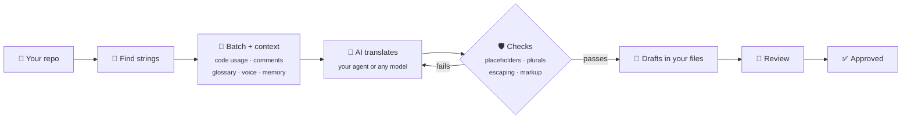

<div align="center">

# 🌍 Localship

**Translate your app with the AI you already use.**

Free and open source · No account, no server · Any AI model · Every translation checked

[](https://github.com/jigarfumakiya/localship/actions/workflows/ci.yml)
[](LICENSE)
[](https://modelcontextprotocol.io)
[](CONTRIBUTING.md)

[Highlights](#-highlights) · [See it in action](#-see-it-in-action) · [How it works](#-how-it-works) · [Install](#-install) · [What you can ask](#-what-you-can-ask) · [Formats](#-formats) · [Questions](#-questions) · [Roadmap](#%EF%B8%8F-roadmap) · [Reference](docs/reference.md)

</div>

---

Ask your coding agent to translate your app. Localship gives it the context it needs, checks
every translation before it's written, and remembers what's done, so updates only redo what
changed.

> [!NOTE]
> **Early days.** Localship is new. It's tested on real-world translation files and a real app,
> but expect rough edges, and please [open an issue](https://github.com/jigarfumakiya/localship/issues)
> when you hit one.

## ✨ Highlights

- 🆓 **Free and open source.** MIT-licensed. You pay only for your own AI usage, or nothing with a
  local model.
- 🤖 **Works with the AI you already use.** Your coding agent's own model, or Claude, GPT, Gemini,
  OpenRouter, or a local model through Ollama.
- 🛡️ **Catches broken translations.** Placeholders, plural forms, Android escaping and markup are
  checked in code before anything is written. Failures go back to the AI with the reason.
- 🧠 **More context for the AI.** Each string comes with the code that uses it, its comment, your
  glossary and voice notes, and earlier translations of the same text.
- 🔒 **Stays in your repo.** No server, no account, no upload. Your files, written the way Android
  Studio and Xcode write them.
- 💻 **Runs anywhere.** Claude Code, Cursor, VS Code, Codex, Gemini CLI, Claude Desktop or the
  terminal, on macOS, Linux and Windows.

### 🤔 Why use Localship?

Your AI can already translate a strings file if you ask. Here's what changes with Localship:

| | ❌ Asking an AI directly | ✅ With Localship |
|---|---|---|
| Placeholders like `%1$s` | Sometimes dropped, and the app crashes on that screen | Checked before writing; sent back to fix |
| Plural forms | Arabic often gets 2 forms instead of 6 | The right forms for every language, from Unicode CLDR |
| Android escaping | An unescaped apostrophe breaks the build | Escaped for you |
| Consistent terms | "Budget" translated three ways | Glossary, voice notes and earlier translations |
| Changing copy | Everything is translated again | Only changed strings are redone, with the old and new text |
| Your translator's fixes | Overwritten | Kept unless you ask |

## 🎬 See it in action

```
You:    Translate this app into Hindi and Arabic.
Agent:  Found 18 strings (2 plurals, 3 with placeholders). I'll add a short brief and
        glossary, and keep "Jotter Pro" as written. Say "start translating" to go.

You:    Start translating.
Agent:  36 translations written as drafts, 0 errors. Arabic has all six plural forms.

You:    Review the Arabic, then approve them.
Agent:  Two small fixes made. All approved.

You:    I reworded two buttons. Update the translations.
Agent:  Updated the 2 changed strings. Your hand edit in Hindi was kept.
```

## 🔍 How it works



Setup adds one folder to your repo. Commit it: the brief, glossary and voice notes are yours to
edit, and the lockfile is how Localship knows what's new, what changed and what someone edited by
hand.

```
.localship/
├── config.yaml     where your strings live, and which languages
├── brief.md        what the app is and who it's for
├── glossary.yaml   terms to keep as they are or translate one way
├── voice/          tone and formality per language
└── lock.json       what was translated from which text
```

## 🚀 Install

Needs [Node.js](https://nodejs.org) 22 or newer.

**Claude Code:** install the plugin, which includes the server and the skills.

```
/plugin marketplace add jigarfumakiya/localship
/plugin install localship@localship
```

**Agent skills:** step-by-step playbooks for Codex, Cursor, Gemini CLI and other agents that read
skills. One command:

```sh
npx skills add jigarfumakiya/localship
```

**Other tools:** add Localship as an MCP server.

```json
{ "mcpServers": { "localship": { "command": "npx", "args": ["-y", "github:jigarfumakiya/localship", "mcp"] } } }
```

| Tool | Where the config goes |
|---|---|
| Claude Code (without the plugin) | `claude mcp add localship -- npx -y github:jigarfumakiya/localship mcp` |
| Cursor | `.cursor/mcp.json` in your project, or `~/.cursor/mcp.json` |
| VS Code | `.vscode/mcp.json`, with `"servers"` instead of `"mcpServers"` and `"type": "stdio"` added |
| Gemini CLI | `.gemini/settings.json` |
| Codex | `~/.codex/config.toml`: `[mcp_servers.localship]` with `command = "npx"` and `args = ["-y", "github:jigarfumakiya/localship", "mcp"]` |
| Claude Desktop | `claude_desktop_config.json`, with `"-C", "/path/to/your/app"` added before `"mcp"` |

The first start takes a minute while it installs.

<details>
<summary><b>MCP tools</b></summary>

Your agent picks these itself; you just ask. 👀 marks tools that only read and never change a file.

| Tool | What it does |
|---|---|
| `localship_plan` 👀 | Looks at the project and returns one plan for a request: what it found, blockers, steps and defaults |
| `localship_start` | Sets up a confirmed plan: config, default voice notes and glossary, never overwriting yours |
| `localship_status` 👀 | Progress per language: missing, changed, drafts, approved |
| `localship_validate` 👀 | Checks placeholders, plural forms, escaping, markup and the glossary |
| `localship_detect` 👀 | Finds translation files in the repo |
| `localship_init` | Writes the config from what was detected |
| `localship_add_locales` | Adds languages to translate into |
| `localship_get_context` 👀 | Reads the brief, voice notes and glossary |
| `localship_update_context` | Writes the brief, voice notes or glossary |
| `localship_next_batch` 👀 | The next strings to translate, with their context |
| `localship_submit` | Checks translations and writes the good ones as drafts |
| `localship_approve` | Marks drafts reviewed or approved, when you say so |
| `localship_remove` | Clears translations so they're redone; keeps your edits unless you ask |
| `localship_prune` | Removes translations of deleted strings |
| `localship_translate` | Translates everything missing through a model API, for large apps |

</details>

## 💬 What you can ask

Wherever your app is today, one sentence gets it started.

| Your app today | Just ask |
|---|---|
| 📝 Has strings, no translations yet | "Translate the app into French and German." |
| 🌐 Already has some translations | "Set up localization." Existing translations are kept and checked |
| 🧱 Text is written straight into the code | "Make this app localizable." The agent moves it into `strings.xml` or a String Catalog |
| ➕ Adding a language later | "Add Japanese." |
| ✏️ You changed some copy | "Update the translations." Only changed strings are redone |
| 🧹 You deleted or renamed strings | "Clean up old translations." |
| 👀 Ready to check the result | "Review the Arabic translations." |

## 📦 Formats

| Format | Status |
|---|---|
| Android `strings.xml` | ✅ Supported |
| Apple String Catalog `.xcstrings` | ✅ Supported |
| gettext `.po` / `.pot` | ✅ Supported |
| Flutter ARB `.arb` | 🗓️ Planned |
| JSON (flat, nested, i18next, ICU) | 🗓️ Planned |
| Apple `.strings` / `.stringsdict` | 🗓️ Planned |
| XLIFF `.xliff` | 🗓️ Planned |

Android string arrays and plurals, String Catalog plural variations, and gettext plural forms are
all supported.

## ⌨️ From the command line

No agent needed: run Localship straight from your terminal with any model.

```sh
localship plan hindi arabic                                 # what it takes, before changing anything
localship start hi,ar --model anthropic:claude-sonnet-5-5   # set up and translate in one go
localship status                                            # progress per language
localship validate                                          # exits 1 on errors
localship approve --locale hi                               # after review
```

Every command, option and config key is in the [reference](docs/reference.md).

## ❓ Questions

<details>
<summary><b>The Localship tools don't show up. What do I check?</b></summary>

- Node.js 22 or newer: run `node --version`.
- The first start takes a minute while it installs; try again after that.
- Reconnect the server: `/mcp` in Claude Code, or restart your editor.
- Open your app's folder in your tool, so Localship starts in the right project.
</details>

<details>
<summary><b>Can I try it before using it on my app?</b></summary>

Yes. [examples/android-notes](examples/android-notes) is a small Android app with its Hindi and
Arabic translations. Open it with Localship installed and ask your agent to add another language.
</details>

<details>
<summary><b>Do I need an API key?</b></summary>

No. Inside a coding agent, Localship uses the agent's own model. An API key is only needed to
translate from the terminal or CI, and a local model through Ollama needs none at all.
</details>

<details>
<summary><b>Where do my strings go?</b></summary>

Only to the AI you choose. There's no Localship server.
</details>

<details>
<summary><b>Will it overwrite my translators' work?</b></summary>

No. Hand edits and anything approved are never replaced unless you explicitly ask.
</details>

<details>
<summary><b>I have an iOS and an Android app. Can they share translations?</b></summary>

Yes. One config can list both, and they share the same brief, glossary and voice notes. When the
same text appears in both apps, the earlier translation is offered to the AI, so "Sign in"
reads the same on both.
</details>

<details>
<summary><b>Which languages?</b></summary>

Any. Plural rules come from Unicode's CLDR data, so Arabic gets six plural forms, Russian three and
Japanese one, automatically.
</details>

<details>
<summary><b>How good are the translations?</b></summary>

As good as the model and the context you give it. The brief, voice and glossary make the biggest
difference. The checks catch mechanical errors, not wrong meaning, so review the drafts, ideally
with a native speaker.
</details>

<details>
<summary><b>Does it check right-to-left layout and cut-off text?</b></summary>

Not yet. Localship checks the translation files, not how your app draws them. Charts that don't
mirror, signs on the wrong side of amounts, or text stored in a database won't show up in the
files, so test right-to-left languages on a device before you ship. The agent skills list what
to look for.
</details>

## 🛣️ Roadmap

| | Feature | Status |
|---|---|---|
| 📦 | Android, String Catalog and gettext formats | ✅ Done |
| 🧠 | Translation with context, checks, review, approval and cleanup | ✅ Done |
| 🤖 | MCP server, agent skills, Claude Code plugin | ✅ Done |
| 📥 | npm package (`npx localship`) | 🚧 Next |
| 🧩 | Flutter ARB and JSON (i18next, flat, nested) | 🗓️ Planned |
| ✅ | GitHub Action that checks pull requests | 🗓️ Planned |
| 🔎 | Tools that find hardcoded text in Kotlin and Swift | 🗓️ Planned |
| 👀 | AI reviewer, and a review page for human translators | 🗓️ Planned |
| 🏪 | App Store and Play Store listings | 🗓️ Planned |
| 📱 | Screenshot checks for cut-off and right-to-left text | 🗓️ Planned |

Want something sooner? [Open an issue](https://github.com/jigarfumakiya/localship/issues) or 👍 an existing one.

## 🤝 Contributing

Found a bug or have an idea? [Open an issue](https://github.com/jigarfumakiya/localship/issues).
