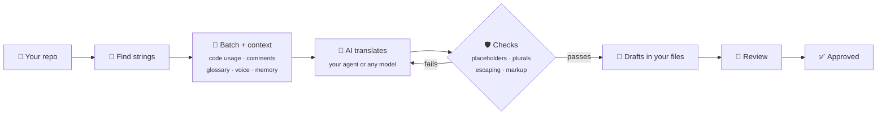

<div align="center">

# 🌍 Localship

**Translate your app with the AI you already use.**
Free, private, and checked so nothing breaks.

[](https://github.com/jigarfumakiya/localship/actions/workflows/ci.yml)
[](LICENSE)
[](https://nodejs.org)
[](https://modelcontextprotocol.io)
[](CONTRIBUTING.md)

[Quick start](#-quick-start) · [Formats](#-formats) · [Why it's different](#-why-its-different) · [AI tools](#-works-with-your-ai-tools) · [Reference](docs/reference.md)

</div>

---

Ask your coding agent to localize your app. **Localship** finds your translation files, gives the
AI the context it needs, checks every translation before it touches your files, and keeps
everything in your repo.

```
You:    Set up localization for this app.
Agent:  Found 312 strings in app/src/main/res. Which languages do you want?
You:    Hindi and Arabic.
Agent:  Done. I drafted a short brief and glossary from your README. Have a look.
You:    Translate the app.
Agent:  624 translations written as drafts, all checks passed.
        Arabic uses all six plural forms; "StillMoney" was kept as written everywhere.
```

## ✨ Highlights

- 🛡️ **Nothing breaks.** Placeholders, plural forms, escaping and markup are checked in code before
  anything is written. Bad translations go back to the AI to fix.
- 🧠 **Translations that fit.** The AI sees the code that shows each string, its comment, your
  glossary, your brand voice, and your other platform's translations.
- 🔒 **Your files stay yours.** No server, no account, no upload. Translations go into the files your
  app already uses, formatted the way Android Studio and Xcode write them.
- 🤖 **Any model.** Your coding agent's own model, or Claude, GPT, Gemini, OpenRouter, or a local
  model through Ollama.
- 💸 **Free.** MIT-licensed. You pay only for your own AI tokens, or nothing with a local model.
- ✋ **People stay in charge.** Translations land as drafts for review. Hand edits and approved
  translations are never overwritten.
- 💻 **Runs anywhere.** macOS, Linux and Windows. As an MCP server, agent skills, or a CLI.

## 📦 Formats

| Format | Used by | Status |
|---|---|---|
| Android `res/values*/strings.xml` | Android apps (Kotlin, Java, Compose) | ✅ Supported |
| Apple String Catalog `.xcstrings` | iOS, iPadOS, macOS, watchOS, visionOS apps | ✅ Supported |
| gettext `.po` / `.pot` | Django, WordPress, Python, PHP, C, Linux apps | ✅ Supported |
| Flutter ARB `.arb` | Flutter apps | 🗓️ Planned |
| JSON (flat, nested, i18next, ICU) | Web apps, React, Vue, React Native | 🗓️ Planned |
| Apple `.strings` / `.stringsdict` | Older iOS and macOS apps | 🗓️ Planned |
| XLIFF `.xliff` | Translation agencies, Angular | 🗓️ Planned |

Android string arrays and plurals, String Catalog plural variations, and gettext plural forms are
all supported. String Catalog substitutions and device variations come next.

## 🆚 Why it's different

| | Cloud localization platforms | Pasting strings into a chatbot | **Localship** |
|---|:---:|:---:|:---:|
| Translations stay in your repo | ❌ Synced to their servers | ✅ | ✅ |
| Price | 💸 Per seat or per word | Your AI plan | **Free** + your AI plan |
| Placeholders and plurals checked before saving | ⚠️ Varies | ❌ | ✅ |
| Context for each string | ⚠️ Screenshots you upload | ❌ | ✅ Read from your code |
| Brand voice and glossary | ✅ | ⚠️ If you paste them each time | ✅ Files in your repo |
| Works with your own AI agent | ⚠️ Some, through their API | ✅ | ✅ |
| Keeps hand edits safe | ✅ | ❌ | ✅ |
| Native file formatting, small diffs | ⚠️ Varies | ❌ | ✅ |

## 🚀 Quick start

**1. Install** in Claude Code:

```
/plugin marketplace add jigarfumakiya/localship
/plugin install localship@localship
```

Using Cursor, Codex, VS Code or another tool? See [Works with your AI tools](#-works-with-your-ai-tools).

**2. Set up.** Open your app's repo and ask:

> 💬 Set up localization for this app.

The agent finds your translation files, asks which languages you want, and drafts a short brief,
voice guide and glossary for you to check.

**3. Translate.**

> 💬 Translate the app into Hindi and Arabic.

**4. Review and ship.**

> 💬 Review the Arabic translations.

When you're happy, say "approve them" and build your app as usual. 🎉

## 🧭 Wherever you're starting from

| Your app today | Just ask |
|---|---|
| 🌐 **Already has some translations** | "Set up localization." Existing translations are kept and checked for real bugs, and you decide whether to trust or review them |
| 📝 **Has strings, no translations yet** | "Translate the app into French and German." |
| 🧱 **Text is written straight into the code** | "Make this app localizable." The agent moves the text into `strings.xml` or a String Catalog without changing what the app does |
| ➕ **Adding a language later** | "Add Japanese." |
| ✏️ **You changed some copy** | "Update the translations." Only changed strings are redone, and the AI sees what changed |
| 🌿 **New strings in a feature branch** | "Translate the new strings." |
| 🧹 **You deleted or renamed strings** | "Clean up old translations." |

## 🤖 Works with your AI tools

Localship is an [MCP server](https://modelcontextprotocol.io) plus agent skills. Add the server
to your tool, then ask in plain words as above.

```json
{
  "mcpServers": {
    "localship": { "command": "npx", "args": ["-y", "github:jigarfumakiya/localship", "mcp"] }
  }
}
```

| Tool | Where it goes |
|---|---|
| **Claude Code** | The plugin above, or `claude mcp add localship -- npx -y github:jigarfumakiya/localship mcp` |
| **Cursor** | `.cursor/mcp.json` in your project, or `~/.cursor/mcp.json` |
| **VS Code** | `.vscode/mcp.json`, with `"servers"` instead of `"mcpServers"` and `"type": "stdio"` added |
| **Gemini CLI** | `.gemini/settings.json` |
| **Codex** | `~/.codex/config.toml`: `[mcp_servers.localship]` with `command = "npx"` and `args = ["-y", "github:jigarfumakiya/localship", "mcp"]` |
| **Claude Desktop** | The JSON above, with `"-C", "/path/to/your/app"` before `"mcp"` |

⏱️ The first start takes a minute while it installs; after that it's quick.

For agents that read skills (Claude Code, Codex, Cursor, Gemini CLI…), add the step-by-step
playbooks for setting up, making an app localizable, translating and reviewing:

```sh
npx skills add jigarfumakiya/localship
```

## ⌨️ Without an agent

Everything also works from the terminal, which is handy for big apps and CI:

```sh
npm install -g github:jigarfumakiya/localship

localship init                                            # find your files, pick languages
localship translate --model anthropic:claude-sonnet-5-5   # or openai:…, gemini:…, ollama:…
localship validate                                        # exits 1 on errors: use it in CI
localship approve
```

## 🔍 How it works



Failed checks go back to the AI with the reason, so it can fix them. Translation state lives in a
small lockfile next to your config, so the tool knows what's new, what changed and what someone
edited by hand.

## ❓ Questions

<details>
<summary><b>Where do my strings go?</b></summary>

Only to the AI you choose. There's no Localship server.
</details>

<details>
<summary><b>Will it overwrite my translators' work?</b></summary>

No. Hand edits and anything approved are never replaced unless you explicitly ask.
</details>

<details>
<summary><b>Which languages?</b></summary>

Any. Plural rules come from Unicode's CLDR data, so Arabic gets six plural forms, Russian three and
Japanese one, automatically.
</details>

<details>
<summary><b>How good are the translations?</b></summary>

As good as the model and the context. The brief, voice and glossary make the biggest difference;
the checks make sure nothing breaks your app. See a real result in
[examples/android-notes](examples/android-notes).
</details>

<details>
<summary><b>Is it ready?</b></summary>

It's young but working: setup, translation, checks, review and cleanup work for the three supported
formats, on macOS, Linux and Windows. See the [plan](PLAN.md) for what's next.
</details>

## 🛣️ Roadmap

- [x] Android, String Catalog and gettext formats
- [x] Setup, translation with context, checks, review, approval and cleanup
- [x] MCP server, agent skills, Claude Code plugin
- [ ] npm package (`npx localship`)
- [ ] Tools to find hardcoded text in Kotlin and Swift
- [ ] Flutter ARB, JSON and Apple `.strings` formats
- [ ] GitHub Action for pull requests
- [ ] AI reviewer with scores, and a review page for human translators
- [ ] Store listings, and visual checks for cut-off or right-to-left text

## 📚 Learn more

- 📖 [Reference](docs/reference.md): every command, option, config key, format detail and check
- 🧪 [Example](examples/android-notes): a small app translated into Hindi and Arabic
- 🤝 [Contributing](CONTRIBUTING.md): development setup and how the code is laid out
- 🗺️ [Plan](PLAN.md) and [research](RESEARCH.md): where this is going, and how it compares to paid tools

## 📄 License

[MIT](LICENSE)
