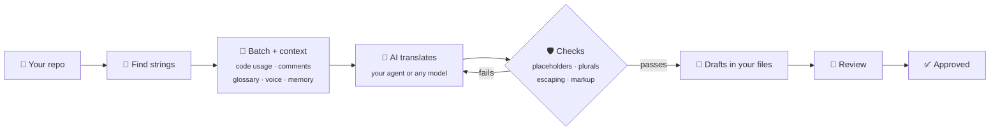

<div align="center">

# 🌍 Localship

**Translate your app with the AI you already use.**
Free, local-first, and every translation is checked before it's written.

[](https://github.com/jigarfumakiya/localship/actions/workflows/ci.yml)
[](LICENSE)
[](https://nodejs.org)
[](https://modelcontextprotocol.io)
[](CONTRIBUTING.md)

[Quick start](#-quick-start) · [Formats](#-formats) · [When to use it](#-when-to-use-it) · [AI tools](#-works-with-your-ai-tools) · [Reference](docs/reference.md)

</div>

---

Ask your coding agent to localize your app. **Localship** finds your translation files, gives the
AI the context it needs, checks every translation before it touches your files, and keeps
everything in your repo.

```
You:    Set up localization for this app.
Agent:  Found 18 strings in app/src/main/res. Which languages do you want?
You:    Hindi and Arabic.
Agent:  Before translating, I drafted a short brief, voice notes and a glossary. Have a look.
You:    Translate the app.
Agent:  36 translations written as drafts, 0 errors. Arabic has all six plural forms,
        and "Jotter Pro" was kept as written.
```

<sub>From the example app in [examples/android-notes](examples/android-notes).</sub>

> [!NOTE]
> **Early days.** Localship is tested on real-world files (AndroidX resources, Django's
> translations, open-source String Catalogs) and a small example app, but it hasn't been used to
> ship a production app yet. Expect rough edges, and please [open an issue](https://github.com/jigarfumakiya/localship/issues) when you hit one.

## ✨ Highlights

- 🛡️ **Catches broken translations.** Missing or mismatched placeholders, missing plural forms,
  Android escaping and markup are checked in code before anything is written. Translations that
  fail go back to the AI with the reason.
- 🧠 **More context for the AI.** Each string comes with the code that uses it, its comment, your
  glossary and voice notes, and translations of the same text elsewhere in your project.
- 🔒 **Your files stay yours.** No server, no account, no upload. Translations go into the files your
  app already uses, formatted the way Android Studio and Xcode write them.
- 🤖 **Any model.** Your coding agent's own model, or Claude, GPT, Gemini, OpenRouter, or a local
  model through Ollama.
- 💸 **Free.** MIT-licensed. You pay only for your own AI tokens, or nothing with a local model.
- ✋ **People stay in charge.** Translations land as drafts for review. Hand edits and approved
  translations are never overwritten unless you ask.
- 💻 **Runs anywhere.** macOS, Linux and Windows. As an MCP server, agent skills, or a CLI.

## 📦 Formats

| Format | Used by | Status |
|---|---|---|
| Android `res/values*/strings.xml` | Android apps (Kotlin, Java, Compose) | ✅ Supported |
| Apple String Catalog `.xcstrings` | iOS, iPadOS, macOS, watchOS, visionOS apps | ✅ Supported |
| gettext `.po` / `.pot` | Django, WordPress, Python, PHP, C, Linux apps | ✅ Supported |
| Flutter ARB `.arb` | Flutter apps | 🗓️ Planned |
| JSON (flat, nested, i18next, ICU) | Web apps, React, Vue, React Native | 🗓️ Planned |
| Apple `.strings` / `.stringsdict` | Older iOS and macOS apps | 🗓️ Planned |
| XLIFF `.xliff` | Translation agencies, Angular | 🗓️ Planned |

Android string arrays and plurals, String Catalog plural variations, and gettext plural forms are
all supported. String Catalog substitutions and device variations come next.

## 🤔 When to use it

Your coding agent can already translate a `strings.xml` file if you ask. Localship is for when
that stops being enough:

- **You localize continuously.** It tracks what's new, what changed since it was translated and
  what someone edited by hand, so each run only does the work that's needed.
- **You have plurals and placeholders.** Models regularly drop a `%1$s`, miss Arabic or Russian
  plural forms, or leave an Android apostrophe unescaped. These are caught before they reach your
  files, not at build time or in production.
- **You want consistency.** A glossary, voice notes and earlier translations keep terms and tone
  the same across hundreds of strings and both platforms.
- **You don't want a cloud platform.** Everything stays in your repo, with any model you like.

If you just need a handful of strings translated once, asking your agent directly is fine.

What the checks can't do is judge meaning or tone. That's what review is for.

## 🚀 Quick start

**1. Install** in Claude Code:

```
/plugin marketplace add jigarfumakiya/localship
/plugin install localship@localship
```

Using Cursor, Codex, VS Code or another tool? See [Works with your AI tools](#-works-with-your-ai-tools).

**2. Ask.** Open your app's repo and say what you want:

> 💬 Translate this app into Hindi and Arabic.

You get one short plan: what it found, what it will do, and the defaults it picked (like
formality per language, and your app's name kept as written). Change anything in your reply.

**3. Say "start translating".** It sets everything up, writes a short brief, translates every
string, checks each one, and reports back. No more questions unless something is truly blocked.

**4. Review and ship.**

> 💬 Review the Arabic translations.

When you're happy, say "approve them" and build your app as usual. 🎉

## 🧭 Wherever you're starting from

| Your app today | Just ask |
|---|---|
| 🌐 **Already has some translations** | "Set up localization." Existing translations are kept and checked for real bugs, and you decide whether to trust or review them |
| 📝 **Has strings, no translations yet** | "Translate the app into French and German." |
| 🧱 **Text is written straight into the code** | "Make this app localizable." The agent follows a step-by-step guide to move the text into `strings.xml` or a String Catalog. Tools that find and check this for you are still to come |
| ➕ **Adding a language later** | "Add Japanese." |
| ✏️ **You changed some copy** | "Update the translations." Only changed strings are redone, and the AI sees what changed |
| 🌿 **New strings in a feature branch** | "Translate the new strings." |
| 🧹 **You deleted or renamed strings** | "Clean up old translations." |

## 🤖 Works with your AI tools

Localship is an [MCP server](https://modelcontextprotocol.io) plus agent skills. Add the server
to your tool, then ask in plain words as above.

```json
{
  "mcpServers": {
    "localship": { "command": "npx", "args": ["-y", "github:jigarfumakiya/localship", "mcp"] }
  }
}
```

| Tool | Where it goes |
|---|---|
| **Claude Code** | The plugin above, or `claude mcp add localship -- npx -y github:jigarfumakiya/localship mcp` |
| **Cursor** | `.cursor/mcp.json` in your project, or `~/.cursor/mcp.json` |
| **VS Code** | `.vscode/mcp.json`, with `"servers"` instead of `"mcpServers"` and `"type": "stdio"` added |
| **Gemini CLI** | `.gemini/settings.json` |
| **Codex** | `~/.codex/config.toml`: `[mcp_servers.localship]` with `command = "npx"` and `args = ["-y", "github:jigarfumakiya/localship", "mcp"]` |
| **Claude Desktop** | The JSON above, with `"-C", "/path/to/your/app"` before `"mcp"` |

⏱️ The first start takes a minute while it installs; after that it's quick.

For agents that read skills (Claude Code, Codex, Cursor, Gemini CLI…), add the step-by-step
playbooks for setting up, making an app localizable, translating and reviewing:

```sh
npx skills add jigarfumakiya/localship
```

## ⌨️ Without an agent

Everything also works from the terminal, which is handy for big apps and CI:

```sh
npm install -g github:jigarfumakiya/localship

localship plan hindi arabic                                   # what it takes, before changing anything
localship start hi,ar --model anthropic:claude-sonnet-5-5     # set up and translate in one go
localship validate                                            # exits 1 on errors: use it in CI
localship approve
```

## 🔍 How it works



Failed checks go back to the AI with the reason, so it can fix them. Translation state lives in a
small lockfile next to your config, so the tool knows what's new, what changed and what someone
edited by hand.

## ❓ Questions

<details>
<summary><b>Where do my strings go?</b></summary>

Only to the AI you choose. There's no Localship server.
</details>

<details>
<summary><b>Will it overwrite my translators' work?</b></summary>

No. Hand edits and anything approved are never replaced unless you explicitly ask.
</details>

<details>
<summary><b>Which languages?</b></summary>

Any. Plural rules come from Unicode's CLDR data, so Arabic gets six plural forms, Russian three and
Japanese one, automatically.
</details>

<details>
<summary><b>How good are the translations?</b></summary>

As good as the model and the context you give it. The brief, voice and glossary make the biggest
difference. The checks catch mechanical errors (placeholders, plural forms, escaping), not wrong
meaning, so review the drafts, ideally with a native speaker. See a real result in
[examples/android-notes](examples/android-notes).
</details>

<details>
<summary><b>Is it ready?</b></summary>

Not for production yet. Setup, translation, checks, review and cleanup work for the three supported
formats on macOS, Linux and Windows, with about 190 automated tests and real-world sample files.
It hasn't been used to ship a real app yet, and translating through a model API hasn't been tried
against a live provider. See the [plan](PLAN.md) for what's next.
</details>

## 🛣️ Roadmap

- [x] Android, String Catalog and gettext formats
- [x] Setup, translation with context, checks, review, approval and cleanup
- [x] MCP server, agent skills, Claude Code plugin
- [ ] npm package (`npx localship`)
- [ ] Tools to find hardcoded text in Kotlin and Swift
- [ ] Flutter ARB, JSON and Apple `.strings` formats
- [ ] GitHub Action for pull requests
- [ ] AI reviewer with scores, and a review page for human translators
- [ ] Store listings, and visual checks for cut-off or right-to-left text

## 📚 Learn more

- 📖 [Reference](docs/reference.md): every command, option, config key, format detail and check
- 🧪 [Example](examples/android-notes): a small app translated into Hindi and Arabic
- 🤝 [Contributing](CONTRIBUTING.md): development setup and how the code is laid out
- 🗺️ [Plan](PLAN.md) and [research](RESEARCH.md): where this is going, and how it compares to paid tools

## 📄 License

[MIT](LICENSE)
